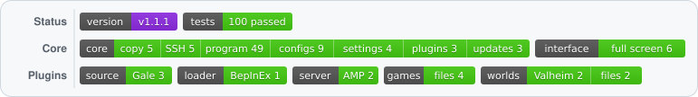
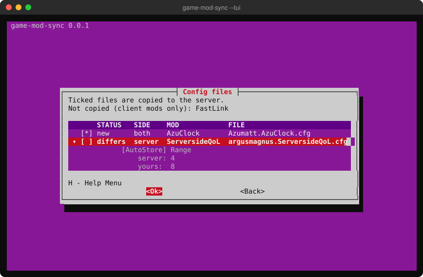
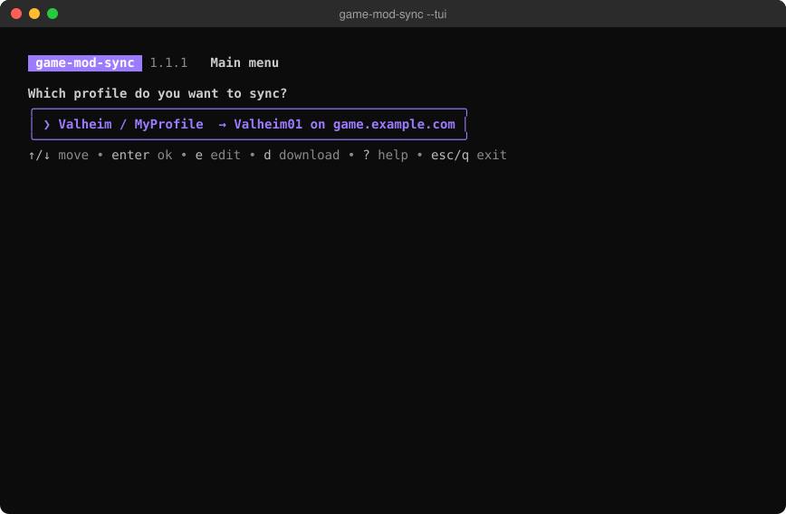
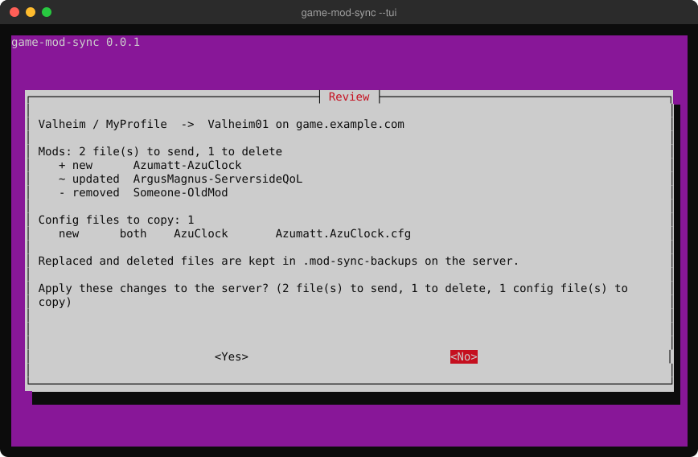
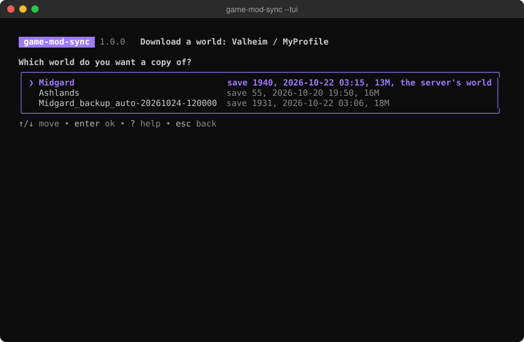
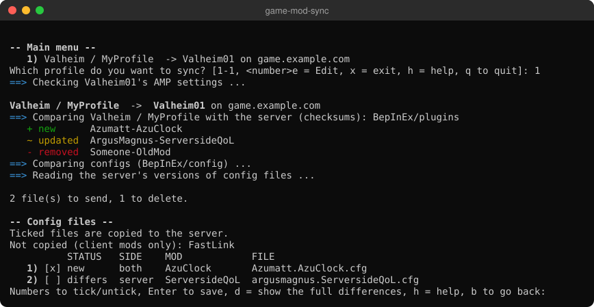
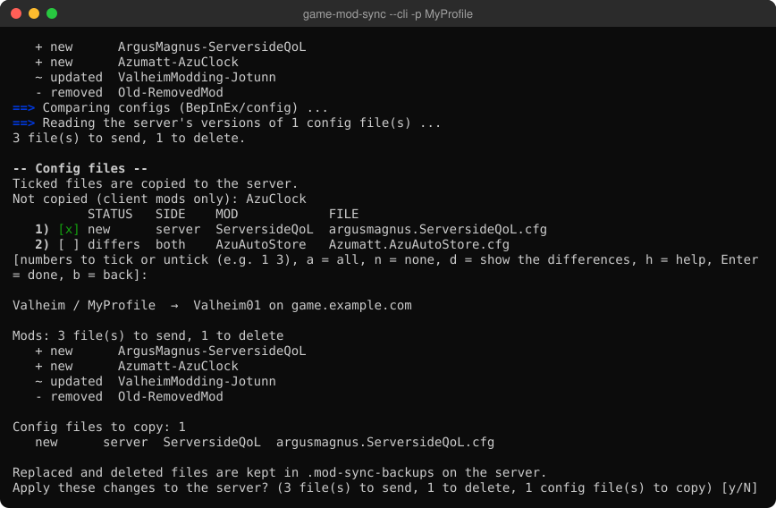

<h1 align="center">game-mod-sync</h1>

  

> [!WARNING]
> **Made with AI.** Written by Claude (Anthropic's AI model), with a human deciding what it should
> do, reviewing the changes and testing it on a real game server. Read the code before you point
> it at yours. It backs up everything it replaces or removes on the server, but use it at your own
> risk.

Sync the mods and config files of your mod-manager profile to your game server, over SFTP or SSH.
It shows what will change before it changes anything, and backs up what it replaces. For some
games it can also copy the server's world to your computer, to test mod updates first.

One program for Windows, macOS and Linux; nothing else to install.

More screenshots

## Install

Download your file from [Releases](https://github.com/doggpound/game-mod-sync/releases/latest),
extract it and run `game-mod-sync`.

| | File |
|---|---|
| Windows | `…-windows-amd64.zip` (`-arm64` for ARM) |
| macOS | `…-macos-arm64.tar.gz` (Apple silicon) or `-macos-amd64` (Intel) |
| Linux | `…-linux-amd64.tar.gz` (or `-arm64`) |

The builds aren't code-signed: on Windows click **More info → Run anyway**, on macOS right-click →
**Open** the first time. Or build it: `go install github.com/doggpound/game-mod-sync@latest`.

## Use

Run `game-mod-sync` and pick a profile. The first time, it asks for your server: its type (or
*Other*), then the address, port, user and password your host gave you (or paste an `sftp://` link),
and it finds the game folder. Passwords can be saved in your system's password store; SSH keys,
agents and `~/.ssh/config` work too.

A sync compares mods by content, offers the config files that are new or differ (with the settings
that differ), then asks before applying. Replaced files are kept in `.mod-sync-backups` on the
server.

Keys: **Enter** sync, **E** edit, **D** download a world, **?** help, **Esc** back.

## Options

| | |
|---|---|
| `--tui` / `--cli` | Full screen (default) / text |
| `-p PROFILE` | That profile, no menu (`-g GAME` if the name is in several games) |
| `-y` | No questions (only new config files are copied) |
| `-n` | Dry run |
| `-v` | List every file and difference |
| `--setup` | Set up a profile's server again |
| `--download-world` | Download the server's world (`--world NAME` for another) |
| `--refresh-tags` | Look the mods' client/server tags up again |
| `--list` / `--games` / `--config` | Profiles' servers / games found / where settings are |

Settings are in `%APPDATA%\game-mod-sync` (Windows) or `~/.config/game-mod-sync`. Settings from
0.x are converted on first start.

## Supported

| | |
|---|---|
| Mod managers | [Gale](https://github.com/Kesomannen/gale) |
| Mod loaders | BepInEx |
| Servers | any SSH or SFTP server; [CubeCoders AMP](https://cubecoders.com/AMP) |
| Games | any BepInEx game; Valheim (with world download) |

More can be added as plugins: [internal/plugins/README.md](internal/plugins/README.md).

## Development

`go build .` and `go test ./...` (no network needed). How it works: [docs/DESIGN.md](docs/DESIGN.md).
Changes go through pull requests; raising `VERSION` (with notes in `docs/releases/`) and merging
publishes a release.

## License

MIT, see [LICENSE](LICENSE).
